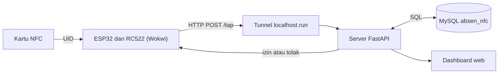
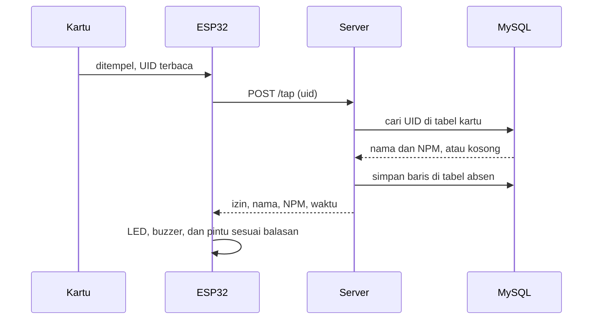

# Absen NFC Perpustakaan

Sistem absensi perpustakaan berbasis IoT: kartu NFC ditempelkan ke pembaca, server mengecek pemilik kartu, pintu terbuka otomatis untuk kartu yang terdaftar, dan riwayat kehadiran langsung tampil di dashboard web. Dibangun dengan **ESP32 + RC522 (simulasi Wokwi)**, **FastAPI**, **MySQL**, dan dashboard **htmx + Tailwind CSS**.

| | |
|---|---|
| **Proyek** | Capstone Project: Sistem Absensi Perpustakaan dengan Kartu NFC |
| **Kelompok** | [isi nama kelompok] |
| **Anggota** | [isi nama dan NPM tiap anggota] |
| **Program Studi** | Sistem Informasi, Universitas Nusantara PGRI Kediri |
| **Mata Kuliah** | Capstone Project |
| **Dosen Pengampu** | [isi nama dosen] |

- **Video demo:** [isi link video]


---

## Daftar Isi

1. [Fitur](#fitur)
2. [Tampilan Aplikasi](#tampilan-aplikasi)
3. [Teknologi](#teknologi)
4. [Arsitektur](#arsitektur)
5. [Rangkaian Perangkat](#rangkaian-perangkat)
6. [Struktur Folder](#struktur-folder)
7. [Struktur Database](#struktur-database)
8. [Alur Sistem](#alur-sistem)
9. [API](#api)
10. [Tutorial Pemasangan](#tutorial-pemasangan)
11. [Keamanan](#keamanan)
12. [Proses Pengembangan](#proses-pengembangan)
13. [Tantangan dan Solusi](#tantangan-dan-solusi)
14. [Pengembangan Lanjutan](#pengembangan-lanjutan)
15. [Referensi dan Kredit](#referensi-dan-kredit)

---

## Fitur

**Absensi dan pintu otomatis**
- ESP32 membaca UID kartu lewat RC522 dan mengirimnya ke server.
- Kartu terdaftar: LED hijau menyala, buzzer berbunyi pendek, dan pintu terbuka 3 detik.
- Kartu tidak dikenal atau server tidak terjangkau: LED merah menyala dan buzzer berbunyi dua kali.
- Di simulasi, pintu diwakili sebuah LED.

**Dashboard**
- Ringkasan hari ini: jumlah diterima, jumlah ditolak, dan jumlah kartu terdaftar.
- 20 riwayat absen terakhir dengan filter Semua, Diterima, dan Ditolak.
- Pembaruan otomatis tiap 5 detik tanpa memuat ulang halaman. Hanya baris yang berubah yang bergerak.
- Responsif: sidebar di layar lebar, menu bawah di HP.

**Manajemen kartu**
- Daftarkan, ubah, dan hapus kartu dari halaman web.
- Setiap kartu menyimpan UID, nama, dan NPM kampus 10 digit (boleh kosong).
- Mendaftarkan UID yang sudah ada memperbarui datanya, bukan membuat data ganda.

**Keamanan**
- Dashboard dan data kartu dilindungi halaman login berbasis sesi, pengguna dan sandinya diatur di `.env`. Tersedia tombol **Keluar** di sidebar dan menu bawah.
- Halaman login bergaya sendiri: maskot kartu NFC yang menutup mata saat sandi diketik, serta tombol tampilkan atau sembunyikan sandi.
- Perangkat ESP32 wajib membawa kunci rahasia lewat header `X-API-Key` untuk memanggil `/tap`.
- Server menolak semua permintaan dengan pesan jelas kalau kunci atau sandi belum diatur.

**Data dan integrasi**
- REST API untuk perangkat dan pengujian, dengan dokumentasi interaktif otomatis di `/docs`.
- Skema tabel dibuat otomatis saat server pertama kali jalan.
- Skrip migrasi untuk memindahkan data lama dari SQLite ke MySQL.

---

## Tampilan Aplikasi

### Halaman login


### Dashboard


### Kelola kartu


### Rangkaian di Wokwi


### Serial Monitor saat kartu ditempel


---

## Teknologi

| Bagian | Teknologi |
|---|---|
| Perangkat (simulasi) | ESP32 dan pembaca kartu RC522 (MFRC522) di Wokwi, Arduino C++ (WiFi, HTTPClient, MFRC522) |
| Backend | Python 3.12, FastAPI, Uvicorn, PyMySQL |
| Database | MySQL / MariaDB |
| Dashboard | Jinja2, htmx dan idiomorph, Tailwind CSS (CDN), font Inter |
| Penghubung simulasi | Tunnel localhost.run lewat SSH |
| Versi kontrol | Git dan GitHub |

---

## Arsitektur



**Pembagian tugas:** ESP32 hanya membaca kartu dan menjalankan keputusan (LED, buzzer, pintu). Server memegang semua aturan: siapa yang boleh masuk, pencatatan, dan waktu WIB. Database menyimpan kartu dan riwayat. Dashboard hanya menampilkan.

**Kenapa ada tunnel?** Wokwi berjalan di internet, sehingga tidak bisa menjangkau `localhost` di komputer kita. Tunnel membuat server lokal punya alamat publik sementara. Pada perangkat ESP32 asli yang satu Wi-Fi dengan server, tunnel tidak diperlukan dan cukup memakai alamat IP lokal.

---

## Rangkaian Perangkat

| Komponen | Pin komponen | Pin ESP32 |
|---|---|---|
| RC522 | SDA (SS) | GPIO 5 |
| RC522 | SCK | GPIO 18 |
| RC522 | MOSI | GPIO 23 |
| RC522 | MISO | GPIO 19 |
| RC522 | RST | GPIO 21 |
| RC522 | 3.3V dan GND | 3V3 dan GND |
| LED hijau (akses diterima) | anoda, lewat resistor 220 Ω | GPIO 26 |
| LED merah (akses ditolak) | anoda, lewat resistor 220 Ω | GPIO 33 |
| LED pintu (pengganti kunci) | anoda, lewat resistor 220 Ω | GPIO 32 |
| Buzzer | pin positif | GPIO 13 |
| Katoda semua LED dan buzzer | | GND |

SCK, MOSI, dan MISO adalah pin SPI standar ESP32, tidak ditulis di kode karena memakai pengaturan bawaan. Di sketsa, fungsi `tanyaServer()` mengembalikan `1` (diizinkan), `0` (ditolak), atau `-1` (server tidak terjangkau), dan `loop()` menentukan LED, buzzer, serta pintu dari nilai itu.

---

## Struktur Folder

```
absen-nfc-backend/
├── esp32/
│   └── absen_nfc.ino        # sketsa ESP32 untuk Wokwi
├── server/
│   ├── main.py              # rute API dan halaman dashboard
│   ├── db.py                # koneksi MySQL (pengaturan dibaca dari .env)
│   ├── skema.sql            # skema tabel, dibuat otomatis saat server mulai
│   ├── migrasi_sqlite.py    # pindah data lama dari SQLite ke MySQL
│   ├── requirements.txt     # daftar pustaka Python
│   └── templates/           # halaman dashboard (Jinja2 dan htmx)
│       ├── base.html
│       ├── login.html
│       ├── beranda.html
│       ├── _ringkasan.html
│       ├── kartu.html
│       └── _daftar_kartu.html
├── screenshots/             # gambar untuk dokumentasi
├── mulai_db.sh              # skrip bantu opsional (Linux)
├── mulai_server.sh          # skrip bantu opsional (Linux)
├── mulai_tunnel.sh          # skrip bantu opsional (Linux)
├── .env.example             # contoh pengaturan, salin menjadi .env
└── README.md
```

---

## Struktur Database

Database: `absen_nfc` (utf8mb4).

### Tabel `kartu`

| Kolom | Tipe | Keterangan |
|---|---|---|
| `uid` | VARCHAR(20), PK | nomor seri kartu, 8, 14, atau 20 karakter heksadesimal huruf besar |
| `npm` | VARCHAR(20), NULL | NPM 10 digit, boleh kosong |
| `nama` | VARCHAR(40) | nama pemilik kartu |
| `dibuat` | DATETIME | waktu kartu didaftarkan |

### Tabel `absen`

| Kolom | Tipe | Keterangan |
|---|---|---|
| `id` | INT, PK, AUTO_INCREMENT | |
| `uid` | VARCHAR(20) | UID yang ditempelkan |
| `npm` | VARCHAR(20), NULL | salinan NPM saat tap |
| `nama` | VARCHAR(40) | nama saat tap, `-` untuk kartu tidak dikenal |
| `status` | VARCHAR(10) | `diterima` atau `ditolak` |
| `waktu` | DATETIME | waktu tap (WIB), diberi indeks |

**UID bukan NPM.** UID adalah nomor seri dari pabrik chip dan tidak bisa diganti di kartu biasa, karena itu tabel `kartu` memetakan UID ke NPM. NPM disimpan sebagai teks, bukan angka, supaya nol di depan tidak hilang dan tidak kena batas ukuran bilangan bulat. NPM juga disalin ke tabel `absen`, sehingga riwayat tetap menampilkan data saat kejadian walau kartunya kemudian diubah atau dihapus.

---

## Alur Sistem

### Tap kartu



1. ESP32 membaca UID dari RC522 dan mengirim `POST /tap` berisi `uid`.
2. Server mencari UID di tabel `kartu`. Ketemu berarti `diterima`, tidak ketemu berarti `ditolak` dengan nama `-`.
3. Server menyimpan satu baris ke tabel `absen` lengkap dengan waktu WIB, lalu membalas JSON `izin`, `nama`, `npm`, dan `waktu`.
4. ESP32 membaca `izin`. Jika `true`, LED hijau, buzzer, dan pintu terbuka 3 detik. Jika `false`, LED merah dan buzzer dua kali. Balasan selain kode 200 dianggap ditolak.

### Mendaftarkan kartu

Di halaman **Kartu**, UID diisi (8, 14, atau 20 karakter angka 0-9 dan huruf A-F; spasi, titik dua, dan strip dibuang otomatis), nama maksimal 40 karakter, dan NPM opsional 10 digit. Validasi dilakukan di server. Jika UID sudah ada, nama dan NPM-nya diperbarui.

### Dashboard yang memperbarui diri

Browser meminta bagian ringkasan dari `/dashboard/bagian` tiap 5 detik. Idiomorph membandingkan hasilnya dengan tampilan sekarang dan hanya mengubah bagian yang berbeda, jadi layar tidak berkedip. Baris baru dikenali dari `id` terbesar yang sudah tampil, sehingga hanya baris itu yang berani meluncur masuk.

---

## API

| Metode | Alamat | Fungsi |
|---|---|---|
| POST | `/tap` | Dipanggil ESP32: cek UID, catat absen, balas izin atau tolak |
| GET | `/kartu` | Daftar kartu |
| POST | `/kartu` | Daftarkan atau ubah kartu (`uid`, `nama`, `npm` opsional) |
| DELETE | `/kartu/{uid}` | Hapus kartu |
| GET | `/absen` | 50 riwayat terakhir |
| POST | `/absen` | Catat absen manual |
| GET | `/dashboard` | Halaman beranda |
| GET | `/dashboard/bagian` | Potongan ringkasan untuk pembaruan otomatis |
| GET | `/dashboard/kartu` | Halaman kelola kartu |
| GET | `/login` | Halaman login dashboard |
| POST | `/login` | Proses login, memberi cookie sesi |
| POST | `/logout` | Keluar, menghapus cookie sesi |
| GET | `/docs` | Dokumentasi API interaktif (Swagger) |

Akses: `/tap` dan `POST /absen` memakai header `X-API-Key` (untuk perangkat). Semua alamat lain, kecuali `/`, `/login`, dan `/docs`, meminta login dashboard (cookie sesi).

Contoh balasan `/tap` untuk kartu terdaftar:

```json
{"izin": true, "nama": "Contoh", "npm": "0000000000", "waktu": "2026-11-14 09:30:00"}
```

---

## Tutorial Pemasangan

Panduan ini berlaku untuk Windows, macOS, dan Linux. Ikuti berurutan.

### 1. Siapkan alat

| Alat | Keterangan |
|---|---|
| Python 3.10 atau lebih baru | Cek dengan `python --version` (di macOS atau Linux bisa `python3 --version`) |
| MySQL atau MariaDB | Bisa lewat XAMPP, MySQL Installer, atau paket bawaan Linux |
| Git | Untuk mengambil kode |
| Klien SSH | Sudah bawaan Windows 10/11, macOS, dan Linux (untuk tunnel) |
| Akun Wokwi | Gratis di https://wokwi.com |
| Koneksi internet | Dashboard memuat Tailwind dan htmx dari CDN |

### 2. Ambil kode

```bash
git clone https://github.com/the1975/absen-nfc-backend.git
cd absen-nfc-backend
```

### 3. Siapkan database

Nyalakan MySQL (di XAMPP tekan **Start** pada MySQL). Buka klien MySQL atau tab **SQL** di phpMyAdmin, lalu jalankan:

```sql
CREATE DATABASE absen_nfc CHARACTER SET utf8mb4;
CREATE USER 'absen'@'localhost' IDENTIFIED BY 'ganti_sandi';
GRANT ALL PRIVILEGES ON absen_nfc.* TO 'absen'@'localhost';
FLUSH PRIVILEGES;
```

Ganti `ganti_sandi` dengan sandi pilihan sendiri. **Tabel tidak perlu dibuat manual**, server membuatnya otomatis saat pertama jalan.

### 4. Pasang kebutuhan Python

Disarankan memakai lingkungan virtual:

```bash
python -m venv venv
```

Aktifkan:

| Sistem | Perintah |
|---|---|
| Windows (CMD atau PowerShell) | `venv\Scripts\activate` |
| macOS atau Linux | `source venv/bin/activate` |

Lalu pasang pustaka:

```bash
pip install -r server/requirements.txt
```

### 5. Atur koneksi database

Salin contoh pengaturan menjadi `.env`:

| Sistem | Perintah |
|---|---|
| Windows | `copy .env.example .env` |
| macOS atau Linux | `cp .env.example .env` |

Buka `.env` dan sesuaikan:

| Variabel | Isi |
|---|---|
| `DB_HOST` | `localhost` |
| `DB_PORT` | `3306` (ganti kalau MySQL Anda memakai port lain) |
| `DB_USER` | `absen` |
| `DB_PASSWORD` | sandi yang dibuat di langkah 3 |
| `DB_NAME` | `absen_nfc` |
| `DB_SOCKET` | biarkan kosong |
| `API_KEY` | kunci rahasia untuk ESP32, berupa teks acak (cara membuatnya di bawah) |
| `DASHBOARD_USER` | nama pengguna untuk login dashboard, misalnya `admin` |
| `DASHBOARD_PASSWORD` | sandi untuk login dashboard |
| `SESSION_SECRET` | teks acak panjang untuk menandatangani cookie login |

File `.env` tidak ikut ke GitHub, jadi aman diisi sandi.

Untuk membuat teks acak yang kuat bagi `API_KEY`, `DASHBOARD_PASSWORD`, dan `SESSION_SECRET`, jalankan perintah ini tiga kali dan salin hasilnya:

```bash
python -c "import secrets; print(secrets.token_urlsafe(24))"
```

Server membalas `503` dan menolak semua permintaan kalau keempat isian keamanan ini masih kosong.

### 6. Jalankan server

Masuk ke folder `server`, lalu jalankan:

```bash
cd server
python -m uvicorn main:app --host 0.0.0.0 --port 8000
```

Berhasil jika muncul tulisan `Application startup complete`. Buka **http://localhost:8000/dashboard** di browser. Anda diarahkan ke halaman login: isi `DASHBOARD_USER` dan `DASHBOARD_PASSWORD` dari `.env`. Dashboard masih kosong, itu normal. Tombol **Keluar** ada di sidebar (layar lebar) atau menu bawah (HP).

### 7. Daftarkan kartu

Buka **http://localhost:8000/dashboard/kartu**, tekan tombol tambah, lalu isi:

| Isian | Contoh |
|---|---|
| UID | `AABBCCDD` |
| Nama | nama bebas |
| NPM | 10 digit, boleh dikosongkan |

Untuk uji cepat tanpa Wokwi, buka **http://localhost:8000/docs**, tekan **Authorize**, isi kolom `X-API-Key` dengan `API_KEY` dari `.env`, lalu tutup. Pilih `POST /tap`, tekan **Try it out**, isi `{"uid": "AABBCCDD"}`, lalu **Execute**. Balasan `"izin": true` berarti kartu dikenali, dan barisnya muncul di dashboard.

### 8. Buat simulasi di Wokwi

1. Buka https://wokwi.com, pilih **New Project**, lalu **ESP32**.
2. Tambahkan komponen lewat tombol **+**: **MFRC522** (RC522), 3 **LED** (hijau, merah, dan satu lagi untuk pintu), 3 **resistor 220 Ω**, dan 1 **Buzzer**.
3. Hubungkan sesuai tabel di bagian [Rangkaian Perangkat](#rangkaian-perangkat).
4. Buka **Library Manager** (ikon + di tab kode), cari **MFRC522**, lalu tambahkan.
5. Salin seluruh isi `esp32/absen_nfc.ino` dari repositori ini ke `sketch.ino` di Wokwi.
6. Biarkan dulu isi `URL_DASAR`, kita ubah di langkah berikutnya. Ganti juga `GANTI_KUNCI` pada baris `API_KEY` dengan nilai `API_KEY` dari `.env`.

### 9. Hubungkan Wokwi ke server

Wokwi tidak bisa menjangkau `localhost`, jadi buka tunnel. Biarkan server dari langkah 6 tetap menyala, lalu di terminal **baru** jalankan:

```bash
ssh -R 80:localhost:8000 nokey@localhost.run
```

Jika ditanya soal keaslian host, ketik `yes`. Setelah beberapa detik muncul alamat berbentuk `https://deretan-acak.lhr.life`. Salin alamat itu ke baris ini di sketsa Wokwi:

```cpp
const char* URL_DASAR = "https://deretan-acak.lhr.life";
```

**Alamat tunnel gratis berganti** setiap tunnel dibuka ulang, jadi langkah ini diulang tiap sesi tes. Jika port 8000 sudah dipakai, ganti `8000` di langkah 6 dan perintah SSH dengan port lain.

### 10. Uji coba

Tekan **Play** di Wokwi, tunggu Serial Monitor menampilkan `Wi-Fi tersambung` dan `Siap, tempelkan kartu`. Lalu tempelkan kartu virtual pada RC522 (ikuti petunjuk komponen RC522 di Wokwi untuk mengatur UID kartu).

| Skenario | Hasil yang diharapkan |
|---|---|
| UID yang sudah didaftarkan | Serial: `Selamat datang, <nama>`. LED hijau, buzzer pendek, LED pintu menyala 3 detik. Baris baru berstatus diterima di dashboard |
| UID yang belum didaftarkan | Serial: `Kartu tidak terdaftar, akses ditolak`. LED merah dan buzzer dua kali. Baris berstatus ditolak di dashboard |
| Server atau tunnel mati | Serial: `Server tidak terjangkau, akses ditolak`. LED merah dan buzzer dua kali |

### 11. Masalah yang sering muncul

| Gejala | Penyebab | Solusi |
|---|---|---|
| `Can't connect to MySQL server` | MySQL belum menyala, atau `DB_HOST` dan `DB_PORT` salah | Nyalakan MySQL, cek `.env` |
| `Access denied for user` | Pengguna atau sandi di `.env` berbeda dari yang dibuat di langkah 3 | Samakan, atau buat ulang penggunanya |
| `Unknown database 'absen_nfc'` | Database belum dibuat | Ulangi langkah 3 |
| `No module named ...` | Pustaka belum dipasang atau lingkungan virtual belum aktif | Aktifkan `venv`, ulangi langkah 4 |
| `No module named 'db'` | Server dijalankan dari folder yang salah | Jalankan dari dalam folder `server` |
| Dashboard tampil tanpa gaya | Tidak ada internet untuk memuat CDN | Sambungkan internet |
| Wokwi: `Server tidak terjangkau` (kode `-1`) | Alamat tunnel berganti, tunnel mati, atau server mati | Cek ketiganya, salin alamat tunnel terbaru |
| Wokwi gagal compile, `MFRC522.h` tidak ditemukan | Pustaka belum ditambahkan | Ulangi langkah 8 nomor 4 |
| Wokwi: kartu terdaftar tapi selalu ditolak, Serial menampilkan kode 401 | `API_KEY` di sketsa berbeda dengan di `.env` | Samakan keduanya, lalu jalankan ulang simulasi |
| Server membalas `503` | `API_KEY`, `DASHBOARD_USER`, `DASHBOARD_PASSWORD`, atau `SESSION_SECRET` belum diisi di `.env` | Isi semuanya, lalu restart server |
| Dashboard terus kembali ke halaman login | Sesi sudah lewat 8 jam, `SESSION_SECRET` diganti, atau cookie diblokir browser | Masuk ulang, pastikan cookie browser aktif |

---

## Keamanan

- Semua query ke database memakai parameter (`%s` pada PyMySQL), sehingga aman dari SQL injection.
- Keluaran HTML di-escape otomatis oleh Jinja2, dan pesan galat form di-escape secara eksplisit untuk mencegah XSS.
- Masukan divalidasi ulang di server: UID (8, 14, atau 20 karakter heksadesimal), nama (maksimal 40 karakter), dan NPM (10 digit angka, boleh kosong).
- Kredensial database disimpan di `.env` yang masuk `.gitignore`, sehingga tidak ikut ke repositori.

- Dashboard dan data kartu dilindungi login berbasis sesi. Pengguna dan sandi dibandingkan dengan `secrets.compare_digest` yang tahan serangan waktu, lalu server memberi cookie `sesi` yang ditandatangani HMAC-SHA256 sehingga tidak bisa dipalsukan. Cookie bersifat `HttpOnly` dan `SameSite=Lax`, berlaku 8 jam, dan hanya berstatus `Secure` saat diakses lewat HTTPS.
- Perangkat memanggil `/tap` dengan kunci rahasia di header `X-API-Key`. Tanpa kunci yang benar, server membalas 401.
- Kunci dan sandi disimpan di `.env`, bukan di kode. Kalau belum diatur, server menolak permintaan (503), tidak pernah terbuka secara diam-diam.

**Catatan:** ini prototype. Belum ada pembatasan percobaan login, tombol Keluar hanya menghapus cookie di browser (token yang sudah dicuri tetap sah sampai kedaluwarsa), dan HTTPS bergantung pada tunnel. Kunci API tertanam di sketsa perangkat, jadi siapa pun yang memegang perangkat bisa membacanya. Mengenali orang hanya dari UID juga belum kuat, karena UID pada sebagian kartu bisa disalin.

---

## Proses Pengembangan

Repositori ini berisi backend, dashboard, dan sketsa simulasi perangkat. Pengembangannya bertahap per fase dengan **Claude (Anthropic)** sebagai asisten untuk menyusun draf kode dan menjelaskan konsep, sedangkan arah, keputusan, dan pengujian dilakukan oleh pengembang. Setiap langkah dijalankan dan diuji sebelum lanjut, lalu dicommit dengan awalan `[ADD]`, `[EDIT]`, atau `[DEBUG]` yang diikuti deskripsi apa yang bisa dilakukan sekarang.

| Fase | Hasil | Konsep yang dipelajari |
|---|---|---|
| 1 | Simulasi dasar di Wokwi: LED, tombol, buzzer | Keluaran dan masukan digital GPIO |
| 2 | Pembaca RC522, daftar UID dan nama, LED pintu | SPI, UID kartu NFC |
| 3 | Kirim UID lewat Wi-Fi ke server FastAPI | HTTP POST, JSON, tunnel |
| 4 | Dashboard web dengan pembaruan otomatis | Jinja2, htmx, polling dan morph |
| 5 | Pindah dari SQLite ke MySQL | Skema tabel, query berparameter, migrasi data |
| 6 | NPM pada kartu dan form kelola kartu | Validasi input, kolom opsional, upsert |
| 7 | Pengamanan dasar: login berbasis sesi untuk dashboard dan kunci API perangkat | Cookie sesi bertanda tangan HMAC, API key, `Depends` di FastAPI |
| 8 | Halaman login dengan maskot kartu NFC | Menerjemahkan referensi desain menjadi UI, SVG, dan animasi CSS |
| 9 | Dokumentasi dan tutorial pemasangan | Menulis panduan yang bisa diulang orang lain |

---

## Tantangan dan Solusi

| Masalah | Penyebab | Solusi |
|---|---|---|
| Dashboard menulis "Belum ada tap" dan semua baris berkedip saat pertama dibuka | Rute `/dashboard` terdaftar dua kali, dan FastAPI memakai yang pertama (versi lama) | Versi lama dihapus, tinggal satu fungsi dan satu sumber data |
| Wokwi tidak bisa menjangkau server | Wokwi berjalan di internet, sedangkan server ada di komputer lokal | Tunnel localhost.run memberi alamat publik sementara |
| Alamat tunnel berganti-ganti | Domain gratis dirotasi dan berubah tiap tunnel dibuka ulang | Alamat disalin ulang tiap sesi, dan pada perangkat asli diganti alamat IP lokal |
| Ingin memakai NPM sebagai UID kartu | UID adalah nomor seri chip, tidak bisa diubah | Tabel pemetaan UID ke NPM, dengan NPM disimpan sebagai teks |
| Pindah dari SQLite ke MySQL | Sintaks berbeda (penanda parameter, upsert, tipe waktu) | Lapisan koneksi `db.py` dan skrip migrasi yang aman dijalankan ulang |

---

## Pengembangan Lanjutan

Belum dikerjakan karena di luar ruang lingkup tahap ini:

- Peran pengguna (misalnya admin dan petugas) dan pembatasan percobaan login.
- ESP32 dan RC522 asli dengan alamat IP lokal, tanpa tunnel.
- Kunci pintu sungguhan (relay atau solenoid).
- Sambungan ke database MySQL kampus.
- Ekspor riwayat (CSV) dan rekap kehadiran per NPM.

---

## Referensi dan Kredit

- **Simulator:** [Wokwi](https://wokwi.com/)
- **Backend:** [FastAPI](https://fastapi.tiangolo.com/), [Uvicorn](https://www.uvicorn.org/), [PyMySQL](https://pymysql.readthedocs.io/)
- **Dashboard:** [Jinja2](https://jinja.palletsprojects.com/), [htmx](https://htmx.org/), [idiomorph](https://github.com/bigskysoftware/idiomorph), [Tailwind CSS](https://tailwindcss.com/), font [Inter](https://rsms.me/inter/)
- **Pustaka perangkat:** MFRC522 untuk Arduino
- **Tunnel:** [localhost.run](https://localhost.run/)
- **Asisten pengembangan:** Claude (Anthropic)

